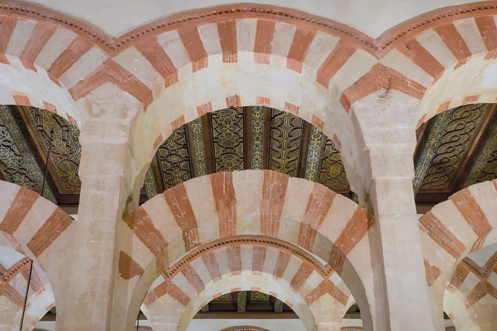
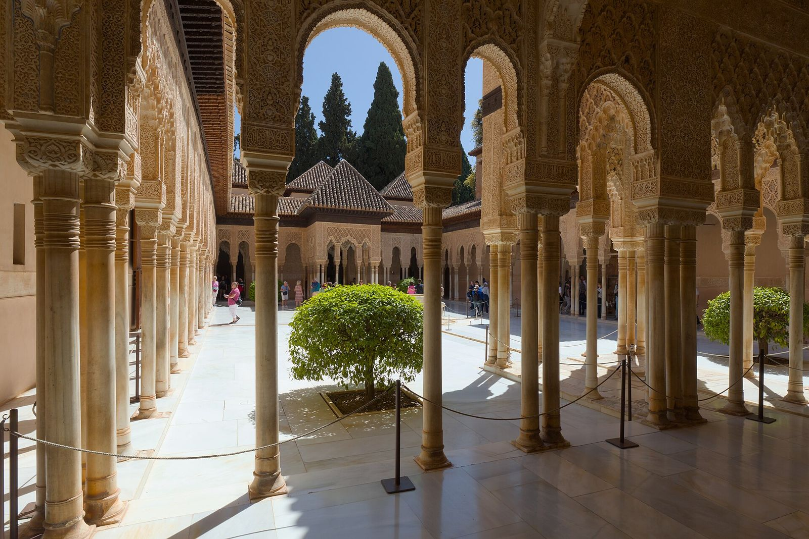
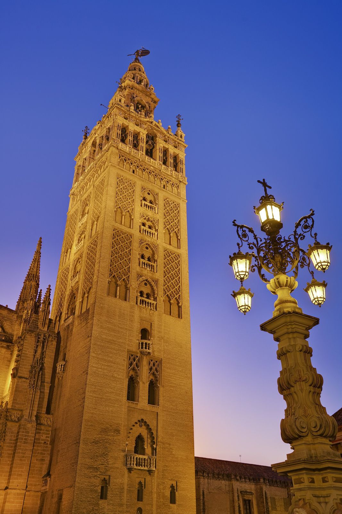

Handout · Referat

# Al-Andalus

Spuren der Mauren in Andalusien, damals und heute

الأندلس

[Dein Name] · [Klasse] · [Datum]

<b>Leitfrage</b>Welche Spuren haben die Mauren in Andalusien hinterlassen, und wo begegnen sie uns heute noch?

## Al-Andalus auf einen Blick

<strong>Al-Andalus</strong> (arab. الأندلس) war der arabische Name für die muslimisch beherrschten Gebiete der Iberischen Halbinsel. Daraus entstand der Name <strong>Andalusien</strong>.

| Jahr | Ereignis |
|---|---|
| 711 | Tariq ibn Ziyad setzt bei Gibraltar über, die Halbinsel wird in wenigen Jahren erobert |
| 756 | Abd ar-Rahman I. gründet das unabhängige Emirat von Córdoba |
| 785 | Baubeginn der Großen Moschee (Mezquita) von Córdoba |
| 929 | Abd ar-Rahman III. ruft das Kalifat von Córdoba aus, Blütezeit |
| 1031 | Das Kalifat zerfällt in viele kleine Taifa-Königreiche |
| 1236 / 1248 | Reconquista: Córdoba und Sevilla werden christlich |
| 1238 | Die Nasriden herrschen in Granada, Bau der Alhambra |
| 1492 | Granada fällt an die Katholischen Könige, Ende von Al-Andalus |
| 1609–1614 | Vertreibung der Morisken (zwangsgetaufte Nachfahren der Muslime) |

<b>Merke:</b> Von 711 bis 1492 vergehen <strong>781 Jahre</strong>. So lange gab es muslimische Herrschaft auf der Iberischen Halbinsel, in Andalusien besonders lange.

## Wer waren die „Mauren“?

- Das Wort kommt von lat. *Mauri*, den Bewohnern Nordwestafrikas.
- Gemeint sind die **Muslime in Spanien**: eine arabische Oberschicht, viele **Berber** aus Nordafrika und Einheimische, die zum Islam übertraten.

- **Convivencia** („Zusammenleben“): Muslime, Christen und Juden lebten Seite an Seite.
- Nicht gleichberechtigt (Sondersteuer für Nicht-Muslime), aber für das Mittelalter vergleichsweise tolerant. Das ermöglichte einen großen Wissensaustausch.

---

## Architektur: die drei großen Bauwerke

<h3>Mezquita · Córdoba</h3>

- Baubeginn **785**, bis ins 10. Jh. erweitert
- rund **850 Säulen**, rot-weiße Doppelbögen
- seit 1236 Kirche, ab 1523 Kathedrale *in* der Moschee

<h3>Alhambra · Granada</h3>

- *al-qalʿa al-ḥamrāʾ* = „die rote Burg“
- Palaststadt der **Nasriden**, 13.–14. Jh.
- Löwenhof, Myrtenhof, Wasser als Bild des Paradieses
- UNESCO-Welterbe seit 1984

<h3>Giralda &amp; Alcázar · Sevilla</h3>

- Giralda: **Minarett** (1184–1198), 1568 Glockenturm aufgesetzt
- Real Alcázar: christlicher König **Peter I.** baut ab 1364 im maurischen Stil

## Fünf Bauelemente zum Erkennen

<b>Hufeisenbogen</b>wird unten wieder enger, oft rot-weiß

<b>Patio</b>Innenhof mit Brunnen, Wasser und Pflanzen

<b>Alicatado</b>Mosaik aus geschnittenen Fliesen

<b>Arabeske</b>Ranken, Sterne und Schrift, keine Menschen

<b>Muqarnas</b>„Stalaktiten“-Gewölbe aus Waben

## Der Stil lebt weiter

<h3>Mudéjar (12.–16. Jh.)</h3>

<strong>Mudéjares</strong> waren Muslime, die unter christlicher Herrschaft blieben. Sie bauten für christliche Herren Kirchen und Paläste im maurischen Stil.

<h3>Neo-Mudéjar (19./20. Jh.)</h3>

Bewusste Wiederbelebung des Stils, z. B. die <strong>Plaza de España</strong> in Sevilla (1929), Stierkampfarenen und Bahnhöfe. Der maurische Stil wird zum Markenzeichen Andalusiens.

<b>Merke:</b> Nach der Reconquista wurden maurische Bauten meist <strong>nicht zerstört</strong>, sondern <strong>umgebaut</strong> (Moschee → Kathedrale, Minarett → Glockenturm) oder sogar <strong>nachgeahmt</strong> (Alcázar, Plaza de España). Maurische Kunst galt als Luxus.

---

## Alltag heute: Sprache

Im Spanischen stammen rund <strong>4.000 Wörter</strong> aus dem Arabischen. Viele beginnen mit <strong>al-</strong> oder <strong>a-</strong>, dem arabischen Artikel.

| Spanisch | Bedeutung · Herkunft |
|---|---|
| aceite | Öl ← *az-zayt* |
| azúcar | Zucker ← *as-sukkar* |
| almohada | Kissen ← *al-mikhadda* |
| ojalá | hoffentlich ← *law šāʾa llāh* („so Gott will“) |

| Ortsname | Herkunft |
|---|---|
| Guadalquivir | *al-wādī al-kabīr*, „großer Fluss“ |
| Gibraltar | *ǧabal Ṭāriq*, „Berg des Tariq“ |
| Alcalá | *al-qalʿa*, „die Burg“ |
| Andalucía | *al-Andalus* |

<strong>Auch im Deutschen:</strong> Algebra, Ziffer, Zucker, Magazin, Alkohol

## Essen, Wasser und Wissen

- **Mitgebracht oder verbreitet:** Bitterorangen, Zitronen, Reis, Safran, Auberginen, Zuckerrohr, Mandelanbau
- **Bewässerung:** Kanäle (*acequias*) und Schöpfräder (*norias*), teils bis heute genutzt
- **Patios:** Die *Fiesta de los Patios* in Córdoba ist seit 2012 immaterielles UNESCO-Kulturerbe

- **Córdoba** war im 10. Jh. eine der größten Städte Europas
- **Ibn Ruschd (Averroes)**, **Maimonides** und **az-Zahrawi** (Chirurgie) wirkten in Al-Andalus
- Die **Ziffern 0–9** kamen über Al-Andalus nach Europa, in **Toledo** wurde arabisches Wissen ins Lateinische übersetzt

## Fachbegriffe

<dl class="glossar">
<dt>Reconquista</dt><dd>christliche „Rückeroberung“ der Iberischen Halbinsel (ca. 722–1492)</dd>
<dt>Convivencia</dt><dd>Zusammenleben von Muslimen, Christen und Juden in Al-Andalus</dd>
<dt>Mihrab</dt><dd>Gebetsnische einer Moschee, zeigt die Richtung nach Mekka</dd>
<dt>Minarett</dt><dd>Turm einer Moschee, von dem zum Gebet gerufen wird</dd>
<dt>Morisken</dt><dd>zwangsgetaufte Muslime und ihre Nachfahren nach 1492</dd>
<dt>Mudéjar</dt><dd>Muslime unter christlicher Herrschaft und ihr Baustil</dd>
</dl>

<h3>Fazit: Antwort auf die Leitfrage</h3>

Die Spuren der Mauren kann man <strong>sehen</strong> (Mezquita, Alhambra, Giralda), <strong>hören</strong> (ojalá, Guadalquivir), <strong>schmecken</strong> (Orangen, Reis, Safran) und <strong>denken</strong> (Ziffern, Algebra, Philosophie). Al-Andalus endete 1492, seine Spuren prägen Andalusien bis heute.

<strong>Quellen:</strong> Bossong, Georg: Das maurische Spanien. C.H.Beck, 2. Aufl. 2010 · Clot, André: Das maurische Spanien. Albatros, 2002 · UNESCO World Heritage Centre (Nr. 313, 314, 383, 1560), whc.unesco.org · Real Academia Española, dle.rae.es

<strong>Bilder (Wikimedia Commons):</strong> Mezquita, Löwenhof, Generalife: Benjamin Smith, CC BY-SA 4.0 · Giralda: Diliff, CC BY-SA 3.0 · Bögen: Alvaro.vinuela.carnicero, CC BY-SA 4.0 · Alicatado: Jl FilpoC, CC BY 4.0 · Arabeske: Jebulon, CC0 · Muqarnas: José Luis Filpo Cabana, CC BY 3.0

